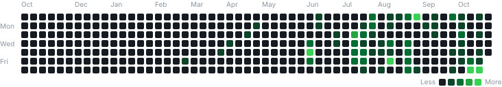

<div align="center">

# 👋 Olá, eu sou Márcio Reis

### Full Stack Developer • JavaScript • Node.js • React • Python

Desenvolvo aplicações web, APIs e sistemas orientados a dados, com foco em **Full Stack Development** e **Engenharia de Software**.

<br>

<a href="https://linkedin.com/in/marciodevjr">
  
</a>

</div>

<br><br>


<table>
<tr>

<td width="55%" valign="top">

## 🚀 Sobre mim

Sou desenvolvedor com foco em **Full Stack Development**, construindo aplicações web e sistemas que conectam **front-end, back-end, bancos de dados, APIs, testes e deploy**.

Atualmente concentro meus estudos e projetos em:

- 🌐 Desenvolvimento Front-end
- ⚙️ Desenvolvimento Back-end
- 🔌 APIs REST e integração entre serviços
- 🗃️ Bancos de dados relacionais e NoSQL
- 🧪 Testes automatizados
- 🧱 Arquitetura e organização de software
- 🤖 AI Engineering
- 📊 Sistemas orientados a dados

Meu objetivo é transformar conhecimento técnico em **software funcional, bem estruturado, documentado e demonstrável**.

</td>

</tr>
</table>

---

## 🎯 Atualmente

🎓 Cursando **Full Stack Developer — Programa Autonomia e Renda, SENAI + Petrobras**

🌐 Desenvolvendo um novo **portfólio web em HTML, CSS e JavaScript** para centralizar meus principais projetos e competências

🤖 Evoluindo o **AI Operations Room** como case de Engenharia de Software e AI Engineering

📊 Consolidando o **Laboratório Quantitativo** como aplicação orientada a dados, testes e deploy

📈 Mantendo o **US Quant Factor Dashboard** como case de software aplicado à análise quantitativa

⚙️ Aprofundando conhecimentos em **APIs, arquitetura, testes, bancos de dados e desenvolvimento de aplicações completas**

---

# 🚀 Projetos em Destaque

Os projetos abaixo representam diferentes aplicações das minhas competências em **desenvolvimento de software**, usando AI e análise quantitativa como áreas de especialização.

## 🤖 AI Operations Room

Projeto de software voltado para exploração de **AI Engineering, arquitetura modular, persistência, configuração e testes automatizados**.

O foco atual é consolidar um MVP estável e demonstrável, com atenção à organização do código, confiabilidade e documentação técnica.

**Competências demonstradas:**

`Python` `Software Architecture` `Testing` `Persistence` `AI Engineering` `Git`

🔗 [Ver repositório](https://github.com/kamikazedojapan/AIOperationsRoom)

---

## 🧪 Laboratório Quantitativo

Aplicação para pesquisa, backtesting e avaliação de estratégias quantitativas, desenvolvida como um ambiente reproduzível para experimentação e análise.

O projeto demonstra construção de software orientado a dados, interface interativa, testes automatizados e publicação de uma versão pública.

**Competências demonstradas:**

`Python` `Pandas` `NumPy` `Streamlit` `Pytest` `Data Analysis` `Deploy`

🔗 [Ver repositório](https://github.com/kamikazedojapan/Laboratorio-Quantitativo)

---

## 📊 US Quant Factor Dashboard

Dashboard de pesquisa multifatorial para análise sistemática de ações do mercado americano.

O projeto transforma conceitos de **factor investing** em uma aplicação estruturada, combinando processamento de dados, ranking multifatorial, visualização e testes.

**Competências demonstradas:**

`Python` `Pandas` `Streamlit` `Data Processing` `Testing` `Quantitative Research`

🔗 [Ver repositório](https://github.com/kamikazedojapan/US-Quant-Factor-Dashboard)

---

# 🛠️ Tech Stack

## 🌐 Front-end


---

## ⚙️ Back-end


---

## 🗃️ Bancos de Dados


---

## 📊 Data & AI


---

## 🧰 Engenharia & Ferramentas


---

# 📚 Foco de Desenvolvimento

```text
Full Stack Development
│
├── 🌐 Front-end
│   ├── HTML semântico
│   ├── CSS responsivo
│   ├── JavaScript
│   ├── TypeScript
│   └── React
│
├── ⚙️ Back-end
│   ├── Node.js
│   ├── Express
│   ├── Python
│   ├── APIs REST
│   └── Autenticação e validação
│
├── 🗃️ Dados
│   ├── MySQL
│   ├── SQLite
│   ├── MongoDB
│   └── Modelagem de dados
│
└── 🧱 Engenharia de Software
    ├── Git & GitHub
    ├── Testes automatizados
    ├── Clean Code
    ├── Arquitetura
    ├── Docker
    └── Deploy
```

---

# 📊 GitHub Analytics

<div align="center">


</div>

<div align="center">


</div>

---
# 📈 GitHub Activity

<div align="center">

<a href="https://kamikazedojapan.github.io/kamikazedojapan/contributions/">
  
</a>


</div>

---

# 🧠 Developer Profile

```python
marcio = {
    "role": "Full Stack Developer",

    "main_focus": [
        "Web Development",
        "Software Engineering",
        "Backend Development"
    ],

    "stack": {
        "frontend": ["HTML", "CSS", "JavaScript", "TypeScript", "React"],
        "backend": ["Node.js", "Express", "Python", "Ruby on Rails"],
        "databases": ["MySQL", "SQLite", "MongoDB"],
        "tools": ["Git", "GitHub", "Docker"]
    },

    "specializations": [
        "AI Engineering",
        "Data-driven Applications",
        "Quantitative Software"
    ],

    "building": [
        "Full stack applications",
        "APIs and backend systems",
        "Data-driven tools"
    ]
}
```

---

# 🌐 Idiomas

🇧🇷 **Português** — Nativo

🇺🇸 **Inglês** — Fluente

🇪🇸 **Espanhol** — Intermediário

---

# 📫 Vamos conectar?

<div align="center">

<a href="https://linkedin.com/in/marciodevjr">
  
</a>

<a href="https://github.com/kamikazedojapan">
  
</a>

<a href="mailto:vi.nimarcio@hotmail.com">
  
</a>

</div>

---

<div align="center">

### 🌐 Full Stack • Software Engineering • Data • AI

*"Construindo software, transformando conhecimento em projetos reais."*

</div>